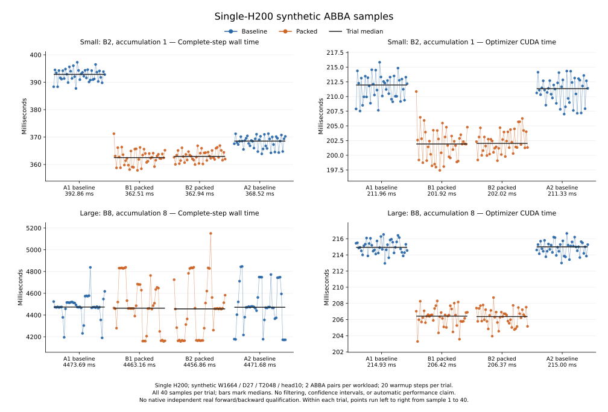

# Persistent Muon parameter storage for encoder-decoder SFT

The project-owned packing adapter gives each Muon group persistent contiguous
parameter storage, removing its per-step parameter stack and copy-back. It
retains the upstream compiled Muon kernel, AdamW updates, parameter objects,
optimizer group order and checkpoint format. The distributed adapter preserves
reduction/gather order and padded chunk sizes, with separate gather send and
receive buffers.

Opt in with `muon_parameter_packing=true` for SFT or
`distributed.muon_parameter_packing=true` for the synthetic benchmark. Both
default to **false**. Before the simplification described below, production
arithmetic, deterministic small/full-real model checks and the two- and four-rank
NCCL optimizer fixtures passed, as did final campaign integrity.
**There is no verified speedup claim:** inconsistent
host/CUDA timing leaves throughput unqualified. A later instrumented baseline
did not reproduce the discrepancy within its fixed bounds; it does not validate
the earlier timings. A separate native-attention baseline control failed before
the model candidate. The implementation is offered as an explicit opt-in with
these correctness and measurement limits.

The optimizer binds to the raw model after checkpoint loading and final
device/dtype conversion, before training forwards. Rebuild it after parameter or storage replacement,
group membership/order changes, or process-group changes, including
`load_state_dict(assign=True)`. Ordinary parameter updates, learning-rate and
momentum schedules, `assign=False` loads and optimizer resume at the same
distributed topology are supported. Failure after partial distributed work
invalidates the optimizer; restart from a completed checkpoint because
outstanding collectives may still write its storage. See the [configuration reference](../reference/configuration.md#conditioned-sft-optimizer-and-dry-run-controls)
for the surrounding SFT controls.

## Verified evidence and remaining scope

The current simplification removes 137 runtime lines: the optimizer adapter
shrinks from 453 to 352 lines and the profiler loses 36 lines. Both adapters now
share one storage/binding implementation and reuse upstream step dispatch.
Duplicate binding snapshots, test-only properties and a separate optimizer
hyperparameter validator were removed. Packing-specific ownership, aliasing,
storage, autograd-version and distributed-failure protections remain.

Review also reproduced and fixed duplicate distributed step-hook execution
after constructing an upstream optimizer. Both adapters invoke the unwrapped
upstream step under their own `no_grad` and hook wrapper. CPU regressions cover
exactly-once hooks, unchanged updates/state and AdamW-only groups. The focused
suite passed **159 tests** at the simplification checkpoint, with Ruff and type checks passing. Removed cases
checked deleted generic scalar validation, private-buffer tampering or duplicate
coverage; numerical, checkpoint, public-storage mutation and failure tests remain.
The separate repository-wide production-caller check reports the same four
unrelated symbols on this branch and untouched main `22426468` (one failed test,
four passed); it adds no packing-related finding.
The profiler shares its synchronization prelude and rank aggregation, and emits
`null` for components without a complete set of observations.

Muon kernel arguments, optimizer-state updates and collective order are unchanged;
gather bookkeeping no longer duplicates the stored receive-buffer reference.
Profiler timing and synchronization order are unchanged. **This revision
has not been rerun on GPUs**, which are reserved for deadline experiments. The
GPU receipts and source manifests below describe the earlier implementation;
they are preserved as historical evidence, not new-source GPU qualification.

### Final merge review

The final review adds tests and this evidence note; the packing adapter and
profiler are unchanged from `d0cfbaa4d`. Main `5f4fc54c2` advanced during review
with SFT integer-step LR warmup; that change was integrated before final checks.
Three independent reviews covered optimizer admission and storage,
single/distributed updates and failures, SFT loading/compilation/checkpoint order,
and profiler configuration, measurements and reporting. No additional production
defect was found.

- **192 focused CPU tests pass.** The expanded suite covers both checkpoint directions through the
  actual SFT setup/save/load functions and a lazy Dynamo wrapper; malformed
  construction before rebinding; disjoint source views with a shared autograd
  version counter; and failures after earlier distributed gathers have launched.
  Profiler tests exercise standalone/distributed routing, packing and compile
  options, FP8 setup order, diagnostic cleanup and rank-specific output.
  Both checkpoint directions also cross the new warmup boundary with exact
  continued model and optimizer state, including actual `sft.main` with small
  local artifact fixtures and accumulated microbatches.
- The adapter reaches **190/190 executable statements and 64/64 branch outcomes**
  with branch coverage enabled and no exclusions. Coverage demonstrates execution
  of those statements and branches, not every possible program state.
- **320 related CPU cases pass**, including residual-head integration, topology
  inventory, SFT resume, startup, fail-fast, integer warmup and schedule checks.
  Three Gloo cases initially
  could not create sockets in the sandbox; all three passed when rerun with local
  sockets permitted. Three marked cases remain deselected.
- The broader Hydra contract file passes 137 cases and retains 37 failures from
  untouched main `5f4fc54c2` (stale config payload hashes and an outdated preset
  inventory). Review fixed the missing test expectation for the intentional
  default-off packing key: both payload-oracle families now assert it is exactly
  `False` before comparing the original hashes. Unrelated goldens were not repinned.
- An isolated snapshot with byte-identical production source rejected **13/13
  deliberate optimizer faults**: missing version increments (construction,
  single-step and gather), failure poisoning, excluded-owner alias checks,
  zero padding, disjoint gather buffers, pending-send lifetime, parameter views,
  optimizer-state anchoring, learning-rate arithmetic, binding validation and
  exactly-once hooks. Its unmodified control passed all 66 existing adapter cases;
  each mutation failed an intended assertion, with no collection errors. Three
  additional in-memory profiler faults were caught: dropped packing, skipped rank
  aggregation and loss values incorrectly included in timing arrays.
- Changed-file Ruff and type checks, whitespace checks and repository-wide
  Vulture pass. Repository-wide Ruff (two `RUF007` findings), type checking
  (439 diagnostics) and the production-caller ratchet (four unrelated symbols)
  reproduce on untouched main `5f4fc54c2`; these gates are not globally green.
  The repository has no hosted CI checks for this head.

The CPU oracles use eager upstream optimizer kernels, CPU attention references,
scripted optimizer collectives and a Dynamo eager backend. Actual Gloo coverage
above concerns head/checkpoint integration, not the packed NCCL optimizer. These
checks do not qualify CUDA/Inductor, current-source NCCL, production-artifact SFT,
FP8 arithmetic or throughput. Historical GPU evidence retains its original source
scope below, including its earlier trainer without the new default LR warmup.
No new GPU work was launched for this review.

The focused coverage run is reproducible with:

```bash
CUDA_VISIBLE_DEVICES= uv run --no-sync pytest -q \
  tests/steering/test_packed_encoder_decoder_optimizer.py \
  tests/steering/test_packed_optimizer_integration.py \
  tests/scripts/test_encdec_sft_config_surface.py \
  tests/scripts/test_profile_encdec_l22_training.py \
  --cov=steering/conditional/encoder_decoder --cov=scripts/benchmark --cov-branch
```

Production receipts bind the `de4c6772` base, adapter `d995ec99` and sealed runtime
manifest `0e89bf87`; the base revision alone does not identify the new source.
These checks used H200 GPUs and Torch `2.13.0+cu130`.

Before simplification, the focused CPU optimizer, model integration, SFT
configuration and profiler suite passed all 160 cases, with Ruff and type checks
passing. An isolated
integration rehearsal on main `22426468` repeated those 160 cases with the ten
reviewed source/config/test files byte-identical to V2 and all project imports
resolving inside the snapshot. The newer main's evaluation changes were retained;
the rehearsal does not relabel the earlier GPU receipts as a new-source run.
Published commit `248452d79` integrated that source onto `22426468`; all 160
focused CPU tests, Ruff and type checks passed again. The historical
[integration receipt](encdec-sft-head-evidence/integrated-source-evidence.json)
binds that commit's 1,010-file runtime manifest and exercised implementation to
the existing GPU evidence. No GPU checks were repeated after integration or
simplification.
Earlier checks also passed 61 head regressions and two SFT startup smoke cases.
One artifact-dependent startup case failed for a missing local tokenizer cache
on both the candidate and untouched baseline.

| Check | Verified result | Scope still excluded |
|---|---|---|
| [All six production Muon groups](encdec-sft-head-evidence/production-full-groups.json), phase of job 23372822 | All baseline controls and baseline/packed pairs passed three evolving updates per group. The 365 matrices include all 40 residual-head matrices; 13,356 exact/finite metrics and 2,190 nonzero update comparisons passed. Six upstream graphs compiled. | Synthetic gradients, one group at a time, fixed optimizer scalars. No forward/backward, AdamW, SFT opt-in, distributed or peak-memory proof. The campaign later failed its native model baseline; final input integrity passed. |
| [Production shared real gradients](encdec-sft-head-evidence/production-real-common-gradients.json), phase of job 23372822 | Actual SFT opt-in, 401 parameters and 120 state entries per step. Six pair-steps passed 12,534 exact/finite tensor metrics and 216 exact counters; all 40 head matrices were exercised. | One native FLASH producer supplies identical cloned gradients to its peer. No independent paired forward/backward or timing proof. |
| [Production two-rank NCCL fixture](encdec-sft-head-evidence/production-world2-nccl.json), job 23373066 | Four exact, finite updates per rank; native NCCL 2.29.7 futures, zero padding, disjoint gather buffers and version increments passed. Both checkpoint directions continued for two exact updates. | Direct optimizer construction with 11 tensors per model. No full group counts, model forward/backward, SFT opt-in, four-rank or timing proof. |
| [Production four-rank NCCL fixture](encdec-sft-head-evidence/production-packed-nccl-world4-23376183-independent-audit.json), job 23376183 | All 16 rank-steps passed exact, finite parameter/update/state/postgradient checks: 272 parameter-update comparisons and 208 Muon version checks. Native NCCL futures, padding, gather storage, cross-rank hashes and both checkpoint continuations passed; final integrity passed. | Direct optimizer construction with 17 FP32 tensors / 8,538 scalars per model; upstream Muon internally uses BF16. No full production counts, model forward/backward, SFT opt-in, topology migration or timing proof. |
| [Production deterministic small model](encdec-sft-head-evidence/production-small-triton.json), phase of job 23377981 | Baseline/baseline and baseline/production-packed pairs passed three independent evolving steps, with process exit 0. All 3,318 comparisons were exact, including 24 separate LM/FP output probes; all 40 head matrices were exercised. Final campaign integrity passed. | Synthetic B2/GA2, width 512, encoder/decoder depth 4, head depth 10. Strict Triton attention; no native FLASH, full-real, distributed or timing proof. |
| [Production deterministic full real model](encdec-sft-head-evidence/production-real-triton.json), phase of job 23377981 | Actual SFT opt-in and authenticated checkpoint/batches. Both independent three-step pairs passed with exit 0: 12,540 finite tensor comparisons and 216 counters were exact across all 401 parameters and 120 state entries per step. All 40 head matrices were exercised. Final campaign integrity passed. | B2/T2048 with two real microbatches, strict Triton attention. No native FLASH independent parity, distributed training or timing proof. |

The NCCL fixtures cover uneven groups, ranks with no owned matrix, and all
AdamW reduction branches. Their expected-gradient checks account for upstream
AdamW's small/indivisible all-reduce path changing the original gradient to the
rank average; Muon and sharded AdamW leave their source gradients unchanged.
The [four-rank audit](encdec-sft-head-evidence/production-packed-nccl-world4-23376183-independent-audit.md)
authenticates all 46 result files and the batch log. Numerical tensors are not
stored in the rank JSONs; the exact-check evidence comes from the authenticated,
assert-enabled worker, with retained collective traces, counters and model
hashes. The earlier two-rank result remains separate evidence.

The [closed native campaign](encdec-sft-head-evidence/production-native-campaign-closure.json)
failed its small-model baseline control at step 1, before the candidate or any
timing trial. Full LM/FP logits and losses were exact. Two decoder QKV gradients
differed by at most `3.73e-9`; original Muon amplified one update difference to
1.028% relative RMS. All source/helper/runtime/capture final checks passed.
The original tolerances remain unchanged.

The [first production deterministic small-model receipt](encdec-sft-head-evidence/production-small-triton-timeout.json),
job 23378001, completed both three-step pairs exactly: 3,246 finite tensor
metrics and 72 state counters, including full LM/FP outputs, independent
gradients, updates and state. All 40 residual-head matrices received nonzero
gradients by steps 1–2. Source re-verification and every final batch input check
passed. The command nevertheless hit its 1,500-second limit with exit 124;
the campaign failed and neither the full-real gate nor timing ran. The reason
for delayed process exit after saving the complete receipt is unestablished.
The predeclared standard-queue fallback, 23377981, passed both independently
audited model gates, all eight native timing processes and final integrity with
exit 0. Its [terminal audit](encdec-sft-head-evidence/production-native-timing/terminal-audit.json)
authenticates 128 archived files, 31 zero phase exits and all final source,
helper, runtime, checkpoint, capture and prior-evidence checks.

The prospective matched timing comparison is **intentionally deferred** to
reserve GPU capacity. Job 23403364 was held before allocation with zero runtime;
it provides no runtime evidence. Its [frozen protocol](encdec-sft-head-evidence/production-clock-comparison-protocol.md)
requires sixteen fresh-process trials, four pairs per workload, all measured
samples retained, and a complete-step saving above 2 ms in every pair after all
clock and final integrity checks. This margin is a descriptive decision rule,
not a calibrated error bound. The protocol is retained as an unexecuted design,
not a prerequisite for reviewing the default-off implementation using the
existing correctness evidence. Earlier timing validity remains unresolved,
and native independent forward/backward remains unqualified;
deterministic Triton controls do not relabel its failed baseline result.

## Closed production timing; validity unresolved

Job 23377981 used one H200, native FLASH, width 1664, 27 encoder and decoder
layers, context 2048, ten transformer head blocks, 844 outputs and synthetic
padding of 64 segments and 24 features. Each workload ran A1/B1/B2/A2 in fresh
processes, with 20 warmups and all 40 measured steps retained per trial.
B denotes device batch size; GA denotes accumulated microbatches per step.

| Workload / pair | Baseline / packed wall medians | Recorded wall reduction | Optimizer median reduction |
|---|---|---|---|
| B2 / GA1, A1/B1 | 392.857 / 362.507 ms | 30.350 ms / 7.726% | 10.037 ms |
| B2 / GA1, A2/B2 | 368.525 / 362.938 ms | 5.587 ms / 1.516% | 9.309 ms |
| B8 / GA8, A1/B1 | 4473.685 / 4463.163 ms | 10.522 ms / 0.235% | 8.514 ms |
| B8 / GA8, A2/B2 | 4471.675 / 4456.862 ms | 14.814 ms / 0.331% | 8.629 ms |

All four full-precision candidate/baseline wall-median ratios are below one,
passing the direction screen recorded before timing. Two pairs per workload
provide limited replication; no confidence interval or general throughput
claim follows. The [closed analysis](encdec-sft-head-evidence/production-native-timing/analysis.json)
retains all phase samples, fixed-window diagnostics and both pairs. The
[portable timing data](encdec-sft-head-evidence/production-native-timing/timing-data.json)
also preserves every original profile field, loss and memory value, with
deduplicated provenance and explicitly redacted paths. Original artifact hashes
refer to archived bytes; the export is a derived representation.



The [large-workload audit](encdec-sft-head-evidence/production-native-timing/large-audit.json)
found wall-time CVs of 2.49–5.93%, far larger than the paired median differences.
B1's last-ten/first-ten wall-median ratio is 0.9043; B2's is 1.0697. All four
trials also have their largest forward measurement at sample 29. These patterns
are retained, and their cause is unknown.

More seriously, 51 of 160 large-workload samples have wall time below the sum
of their CUDA phases. Per-sample wall minus summed phases ranges from
−297.136 to +396.320 ms. The timer records sequential phase events and then
synchronizes before reading wall time; this discrepancy requires clock/timer
validation. The difference cannot be interpreted as a CPU phase or added to
CUDA medians. Throughput qualification remains unresolved despite the positive
median-direction screen and successful artifact-integrity checks.

An [index and aggregation audit](encdec-sft-head-evidence/production-native-timing/index-alignment-audit.md)
found no sample misalignment. In 47 steps, wall time is shorter even than the
sum of the three separate phase minima in that trial; reassigning recorded
phase values cannot explain those deficits. The cause remains unknown.

The [independently audited baseline clock diagnostic](encdec-sft-head-evidence/production-timing-clock-23380833-independent-audit.md),
job 23380833, completed with exit 0 and all final integrity checks intact. All
20 warmups and 40 measured updates were retained. Independent arithmetic
reproduced every saved per-sample classifier result: no violations or anchor
uncertainties within the fixed 1 ms CUDA allowance and host allowance of
`max(2 ms, 0.001 × whole CUDA span)`. The
[portable audit data](encdec-sft-head-evidence/production-timing-clock-23380833-independent-audit.json)
retains all 60 per-sample observations and extrema. Measured wall time exceeded
the whole CUDA span by 0.137733–0.258638 ms. Tiny first-warmup deficits remained
within that row's allowance, and the final measured forward spike was retained;
no cause is established.

This is bounded non-reproduction in an instrumented baseline, not a matched
performance comparison. Additional clock/stream observations, supplemental
queries and per-step receipt writes change measurement overhead and between-step
cadence. The node, physical GPU, VBIOS, persistence and addressing settings also
differed from the earlier campaign. The diagnostic does not establish clock
accuracy, explain or repair the old timings, or qualify throughput. The
prospective comparison is deferred; this diagnostic supplies no substitute
performance result.

The [small-workload audit](encdec-sft-head-evidence/production-native-timing/small-audit.json)
also finds unequal mixed-clock remainders: medians of 23.444, 3.099, 3.112 and
0.052 ms in ABBA order. Thus the 7.726% first-pair wall reduction cannot be
attributed entirely to packing. No samples were filtered. Each recorded loss is
the final microbatch's loss, so GA8 timing receipts do not check every forward
loss or establish numerical parity.

## Historical prototype observations; throughput unqualified

On `de4c6772`, prototype job 23360533 ran one-H200 ABBA comparisons with eight
warmups and 20 samples per run. Both workloads used width 1664, 27 encoder and
decoder layers, context 2048, ten transformer head blocks, 844 feature outputs,
and synthetic padding of 64 segments and 24 features. B denotes device batch
size; GA denotes accumulated microbatches per optimizer step.

| Workload | Baseline / packed complete-step medians, two pairs | Reduction in step time |
|---|---|---|
| B2 / GA1 | 357.783 / 349.909 ms; 359.519 / 350.092 ms | 2.20%; 2.62% |
| B8 / GA8 | 4405.994 / 4396.767 ms; 4420.174 / 4411.113 ms | 0.209%; 0.205% |

The recorded step-median differences were about 8–9 ms in both workloads.
Optimizer medians differed by 7.793/8.462 ms at B2 and 8.250/8.530 ms at B8.
These historical observations motivated further checks; they are not a verified
speedup of the production adapter. Two pairs provide limited replication, not
confidence intervals or production-adapter qualification.

All samples are retained. B8 A1 includes a 4955.783 ms step with elevated forward
time, and all four large-workload runs show early measured backward transients;
their cause is unestablished. Only the last microbatch's loss was recorded per
step, and those losses were finite. Repeated baseline losses differed slightly,
so timing receipts do not establish parity. The closed production follow-up
above uses 20 warmups and 40 samples per trial; it exposes unresolved timing
inconsistency that requires separate investigation.

## Reproduce the synthetic measurement

The benchmark measures synchronized forward, backward and optimizer work. It
excludes data loading, selection, transfer, evaluation and checkpointing. The
following is a one-GPU B2/GA1 baseline using the verified 3B geometry:

```bash
NANOCHAT_DTYPE=bfloat16 NANOCHAT_ATTN_IMPL=fa4 \
uv run python -m scripts.benchmark.profile_encdec_l22_training \
  mode=distributed 'distributed.model=${topology.model}' \
  topology.model.width=1664 topology.model.decoder_depth=27 \
  topology.model.encoder_depth=27 topology.model.sequence_length=2048 \
  topology.model.feature_vocab_size=844 \
  topology.model.feature_prediction_block=transformer \
  topology.model.feature_prediction_head_layers=10 \
  distributed.muon_parameter_packing=false \
  distributed.device_batch_size=2 distributed.total_batch_size=4096 \
  distributed.padded_segments=64 distributed.padded_features=24 \
  distributed.segment_size=32 distributed.static_max_seg_size=32 \
  distributed.compile_static=auto distributed.warmup_steps=20 \
  distributed.steps=40 distributed.component_diagnostic_steps=0 \
  distributed.trace_dir=out/profiles/sft-head10-baseline \
  output_json=out/profiles/sft-head10-baseline.json
```

Run the packed arm with the flag set to `true` and separate output paths. For
single-GPU B8/GA8, use `distributed.device_batch_size=8` and
`distributed.total_batch_size=131072`. Use matched initial states and paired A/B
ordering, retain every sample, and compare complete steps after fixed numerical
gates pass. Warmups must exercise learned residual branches.

The harness uses SFT's CUDA BF16 autocast with existing parameter dtypes,
prewarms decoder masks and uses the trainer's compiler cache limit of 32.
It records the actual optimizer class and packing flag. Synthetic fixed batches
and optimizer defaults do not reproduce SFT's schedules or completion masks.
Native attention must be checked from actual backend evidence: nanochat's `fa4`
label can also denote FlexAttention's Triton fallback.

The command disables diagnostics, as in the matched timing campaign. Enable
`distributed.component_diagnostic_steps=1` for separate attribution afterward.
Throughput samples precede optional diagnostics. Eager module hooks have a
separate uninstrumented control; packed encoder/cross-attention entries are
unmeasured (`null`). Historical zero entries also mean missing instrumentation.
Operator and kernel totals can describe the same work and must not be added.
Keep `distributed.optimizer_diagnostic_steps=0` with packing: serialized
diagnostics bypass its step lifecycle. Ordinary-step traces remain supported.

## Real-data parity boundary and experiment rationale

Capture 23356828 preserves two real B2/T2048 SFT microbatches, the expanded head,
optimizer groups and source hashes. It has 6,881 supervised LM positions and
1,311 masked positions; encoder shapes `[2,64,63]` and `[2,71,68]` differ from
the synthetic padding. Replay authenticates payload/checkpoint bytes, restores
the captured head and constructs SFT's optimizer. Its compute-only timing still
excludes data construction, distributed reduction, logging, evaluation and saving.

Real replay 23357589 failed its first **baseline-versus-baseline** update before
the packed candidate ran. The `7.45e-9` loss difference passed the tolerance but
failed required exact equality; gradient, update and state comparisons also
failed their fixed limits. No real-data timings ran. Three follow-up baseline
diagnostics initially failed before forward/backward because of a scalar-buffer
hashing bug. Corrected diagnostic collection 23374000 then completed with all
final input checks intact. Warmed native repeats had exact losses but 269/401
gradient tensors failed the fixed limits. Strict deterministic FLASH backward
with block masks was unsupported on H200 in that runtime. Deterministic Triton
repeats and three evolving independent baseline/prototype-packed steps were
exact, exercising all 40 residual-head matrices.

Those diagnostics use the frozen prototype. The production follow-up preserves
tolerances and authenticates its completed optimizer proofs, then runs new
independent deterministic Triton model gates before native timing in fresh
processes. This tests optimizer arithmetic on native gradients and independent
model integration under reproducible gradients separately. It does not establish
independent native FLASH parity or identify the sole cause of native variation.

The earlier `77baf2a3` baselines used AdamW for expanded-head matrices. PR #1737
in `de4c6772` moved residual-head matrices into Muon via `fp_head_matrix_lr`;
historical optimizer layouts cannot qualify the new one. Those earlier H200
traces nevertheless motivated packing: parameter stack/copy-back cost 8.269 ms
at head depth 3 and 8.652 ms at depth 10. These are attribution measurements,
not additive throughput samples or a controlled comparison of head depths.

Muon GEMM autotuning was not promoted: one local variant violated the fixed
update-error gate, while the historical H200 variant showed no clear repeated
complete-step gain. Packing instead preserves the original matrix kernel.
The depth-10 forward/backward trace has zero GPU kernel timestamps/durations,
so those records support kernel identities/counts only. Surviving GPU annotations
retain [historical head-graph spans](encdec-sft-head-evidence/historical-head10-graph-spans.json)
of 6.831 ms forward and 13.828 ms backward at B2/GA1. They do not recover individual
kernel costs or establish a current complete-step contribution. No rejected,
contaminated or incomplete experiment supplies a production speed claim.
