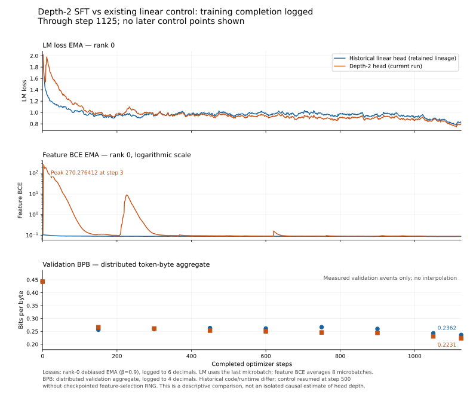

# Depth-2 residual feature head: instruct SFT and ChatCORE

Issue [#1681](https://github.com/Algorithmic-Alignment-Lab/nano-gpt-pretrain-steer/issues/1681)
adds residual capacity before the retained feature projection. This experiment
trained one depth-2 instruct-SFT model from the original pretrained step 250000.
The existing linear-head instruct-SFT step 1125 is the control. There is no new
depth-zero run, depth-one production run, benchmark steering, or GRPO campaign.

The implementation, production qualification and resulting measurements have
separate acceptance gates. A launcher/config or successful tiny-model test does
not establish a completed production result.

## Completed training results — 2026-09-18

Depth-2 production job **22958005 completed 1,125 optimizer steps** on four
H200s, without a training resume or scheduler restart. Slurm reports
`COMPLETED/0:0`; `final_step` and `COMPLETED` identify step 1125 and that job.
The terminal real-feature-conditioned LM validation BPB was **0.2231**, versus
**0.2362** for the historical linear control, a difference of **−0.0131** at
the logged precision. The historical code/runtime and resume differences
described below prevent interpreting this as a causal head-depth comparison.

The compact [training evidence](residual-feature-head-evidence/training-results.json)
records source hashes, validation log lines, metric scopes, timing windows,
rank consumption and checkpoint identities. The figure is a byte-identical
copy of the final rendered artifact. Its historical trace uses initial
invocation steps 1–500 and final resumed invocation steps 501–1125.



| Validation step | Depth 2 BPB | Historical linear BPB | Difference |
|---:|---:|---:|---:|
| 0 | 0.4429 | 0.4429 | +0.0000 |
| 150 | 0.2661 | 0.2564 | +0.0097 |
| 300 | 0.2613 | 0.2588 | +0.0025 |
| 450 | 0.2530 | 0.2632 | −0.0102 |
| 600 | 0.2502 | 0.2614 | −0.0112 |
| 750 | 0.2457 | 0.2665 | −0.0208 |
| 900 | 0.2444 | 0.2598 | −0.0154 |
| 1050 | 0.2306 | 0.2429 | −0.0123 |
| 1125 | 0.2231 | 0.2362 | −0.0131 |

These are measured distributed validation BPBs, logged to four decimals;
they do not measure self-conditioned ChatCORE or held-out feature-head BCE.
The exact persisted `min_val_bpb` values are **0.22311385230889186** and
**0.236180399296458**. They record the best value in each retained training
lineage, rather than an independently persisted full-precision terminal value.

All 1,125 logged LM and feature-loss observations and all nine BPB observations
are finite, with contiguous steps 1–1125. The feature BCE moving average had
recurrent peaks of **270.276412 at step 3**, **8.881493 at step 226**, and
**0.160314 at step 621**, finishing at **0.086892**. Final LM moving average
was **0.802631**; the control's final LM/feature values were
**0.840391 / 0.087089**. These are rank-0 debiased EMAs with beta 0.9. The LM
input is the last accumulation microbatch; the feature input is an unweighted
mean across eight accumulation microbatches. They are neither cross-rank nor
epoch means. The finite endpoint does not erase the observed loss excursions.

| Timed-step window | Steps | Sum of logged step times | Padded input positions/s |
|---|---:|---:|---:|
| Depth 2, steps 1–1125 | 1,125 | 10,100.742 s | 58,394.13 |
| Depth 2, steps 502–1125 | 624 | 5,585.732 s | 58,569.89 |
| Historical linear, steps 502–1125 | 624 | 5,378.561 s | 60,825.88 |

Throughput uses 524,288 padded input positions per optimizer step and times
rounded to milliseconds. It includes work inside the timed training step and
excludes validation, saving and startup outside that step; it is not
supervised-token throughput or measured GPU utilization. The common 502–1125
window excludes the historical resumed first step. Runtime/routing differences
remain, so this is not an isolated estimate of head overhead.

The production allocation ran **10:18:54–14:07:11 UTC**, **3:48:17** elapsed
or **15.218889 allocated H200-hours**, including staging, the separate two-step
canary, startup, validation and saving. Its saved training-time counter is
**9,921.568670988083 s**, summing timed global steps greater than 10. The
historical counter is **16,362.868120908737 s**, including a **6,815.384824 s**
resumed first step. Seven identified historical allocations total **18:34:50**
and include 776 logged completed step ordinals subsequently abandoned/replayed.
These allocation totals and retained counters measure different things.
Production's one failed one-second `du` accounting step was an overlapping
read-only staging probe, not a trainer failure or restart; its time is already
inside the allocation total.

The epoch budget was reached through the existing maximum-across-ranks rule:
rank 2 committed world-scaled consumption of 1,211,616 against 1,210,674 indexed
source rows. Rank 0's final 1,210,644 therefore does not indicate an early stop.
Local packed occurrences sum to 1,210,283 across ranks; they are not unique-row
counts because the source generator wraps. All four saved dataloader states,
including buffered positions, exactly match the historical endpoint, without
establishing identical stochastic feature selections. The first counted
training-buffer pass rejected **106,405 / 1,210,674 indexed rows (8.788906%)**
for fewer than eight supervised targets. This is not a full-run unique-skip,
trained-row, truncation-causation or validation count. Historical logging has a
different trigger/reset behavior, so no matching historical skip count is
claimed.

H200 eager and compiled initial-head equality checks passed at the actual
`(8, 2048, 1664)` BF16 shape. The real two-step canary passed separately from
production. Subsequent CPU inspection job **22983241** strictly loaded the
final depth-2 checkpoint and verified **3,032,489,474 finite parameters**, with
learned nonzero output weights in both residual blocks. All four optimizer
shards safely decoded and matched the production grouping, shapes and Adam
steps, with finite moments and nonnegative second moments. The
[inspection receipt](residual-feature-head-evidence/checkpoint-inspection.json)
binds the final model SHA-256
`d404424912a03b876cc89a318ac994a606c13f4031986b86b6a997ca327e468a`
and unchanged training metadata. This CPU inspection executed neither a model
forward nor an optimizer step; it does not certify an executed production
resume. The same CPU job completed successfully after preparing the evaluation
view: the fresh control and depth-2 measurements both returned cadence 33,
3,257 documents, 40,263 windows and mean `448701/13421`. The view links the
unchanged trained model and changes only the metadata cadence scalar.

### Completed matched ChatCORE results

Both six-task evaluations completed, with **2,420 examples per model**. The
ChatCORE aggregate increased from **0.1660786331300813** for the existing linear
control to **0.19975211720867211** for depth 2, a difference of
**+0.033673484078590804** in raw metric units. The
[results receipt](residual-feature-head-evidence/chatcore-results.json) contains
every task count, result and aggregate hash, checkpoint identity and job record.
All **12 task jobs completed with exit 0:0 and zero scheduler restarts**; both
existing result-merger runs passed their identity and problem-range checks.

| Task | Linear correct/total | Linear accuracy | Depth 2 correct/total | Depth 2 accuracy | Difference (pp) |
|---|---:|---:|---:|---:|---:|
| ARC-Easy | 113/500 | 22.6000% | 135/500 | 27.0000% | +4.4000 |
| ARC-Challenge | 135/500 | 27.0000% | 130/500 | 26.0000% | −1.0000 |
| MMLU | 127/500 | 25.4000% | 141/500 | 28.2000% | +2.8000 |
| GSM8K | 4/500 | 0.8000% | 10/500 | 2.0000% | +1.2000 |
| HumanEval | 9/164 | 5.4878% | 17/164 | 10.3659% | +4.8780 |
| SpellingBee | 239/256 | 93.3594% | 254/256 | 99.2188% | +5.8594 |

Percentages and percentage-point differences are rounded to four decimals;
the integer counts are exact. For task accuracy `a = correct / total`, the
aggregate is the **equal-weight mean of `(a - b) / (1 - b)` across six tasks**,
with `b = 0.25` for ARC-Easy, ARC-Challenge and MMLU, and `b = 0` for the other
three. It has no clipping or example-count weighting and is reported above
without multiplying by 100. Both saved aggregates exactly match the
evaluator's ordered floating-point calculation. The receipt also records an
independent rational calculation; the depth-2 aggregate differs by one ULP
from rounding that rational value to a float.

Both arms used frozen runtime
`50462075083d793d0e9a406fde7e07d08bb9a50c`, the same **227 package versions**,
BF16 without autocast, NVIDIA H200 GPUs and driver **590.48.01**. Evaluation used
seed **1234**, batch size 1, one sample, temperature 0, top-k 50, a 512-token
generation limit, context 2048 and measured cadence 33. The
[cross-model identity review](residual-feature-head-evidence/chatcore-identity-review.json)
verified identical remaining identity fields after accounting for checkpoint
identity and the explicitly reviewed cadence-provenance difference below.
The shared architecture digest covers decoder, encoder and cross-attention
configuration; it excludes feature-head depth and parameters. Distinct model
and metadata hashes bind the two heads.

| Merged result | SHA-256 |
|---|---|
| Linear control | `508935014fdc5306f67ef65d3186d2c740e8543e7e492d37e604b10fa6c0cefa` |
| Depth 2 | `75b15788b080ae8f8f90c85fcd95cf54c67816be170bc6f152d0a0d89c4e1ced` |

This is one fixed-seed comparison, with no variance or significance estimate.
Five task accuracies increased and ARC-Challenge decreased. The historical
training/runtime and resumed feature-selection-RNG confounds still apply;
matching the evaluator does not isolate a causal depth effect. Peak GPU memory
was not measured. Steering evaluation and a GRPO campaign remain deferred.

## Source identities and comparison limits

The historical workspace is
`/orcd/data/dylanhm/001/nano-gpt-pretrain-steer/claude-sft3b-steered-20260905`
(`SOURCE_ROOT` below). Its `base_mask_s32/model_250000.pt` and
`meta_250000.json` link to the original pretrained artifacts. The control is
`base_mask_s32/standard_steered_sft_conditioned_checkpoints/model_001125.pt`
with its sibling metadata. The model family is
`full3b_clustered_c2048_long_w32_bf16_b14_fp`.

| Artifact | SHA-256 |
|---|---|
| Pretrained model, step 250000 | `562e8e214abd996d8a92051b3bd709263cbac519c9081b9d63181a12cddffbcf` |
| Pretrained metadata | `8a8912e8242281a4df6665ad950c9f9fea0ef31a161159257c308a8530c57f72` |
| Control model, step 1125 | `795a5b32687b0c6badb9b849fcadb9acf3d66eca54265ef24bc68ba3b2493da0` |
| Control metadata | `fe13541e383db19ecfc2c1ae96ebc808b99ec3d1f3686cb7a615d9a8eb7c4727` |
| Effective vocabulary | `b68eba18c0469f97931cfbb0ab923debeca3a7b9f1731cc5f84f59c6433e7727` |
| Feature mask file | `bcef403ad3c4bc221b9ebfa9de1431a4896361ece4571f3377897d7f76aa0728` |
| Cluster file | `4aa20b4695d4c583069810fa9a345032ba03fde423df36a7a6a0169348b08246` |

Both model files contain 10,274,993,289 bytes. Their hashes were independently
streamed on Engaging on 2026-09-18; the control hash agrees with its artifact
receipt. No source checkpoint or historical output is modified by the launcher.

The control ran at `aed7b5d00f699f907136146a7d1cf2b790bffdc6`, with repeated
restarts from step 500. Its saved best validation BPB was **0.236180399296458**;
the terminal log reports **0.2362**. The exact best-so-far value is not an
independently recorded exact terminal measurement. These are historical
measurements. It used `missing_percentile_policy=lowest`,
which the new recipe deliberately retains. Neither value is comparable to an
`error`-policy run. SFT's stochastic feature-selection RNG is not checkpointed,
and current source routing differs from that historical code. Re-evaluating
both models with one current ChatCORE runtime controls evaluator differences;
it does not make the training comparison a pure causal estimate of head depth.

## Fixed recipe and launch

The committed recipe is
[`conditional_encdec_sft_3b_residual_head.yaml`](../../configs/training/conditional_encdec_sft_3b_residual_head.yaml).
It keeps normal all-model SFT training and the existing head learning-rate
group. `feature_prediction_block=mlp feature_prediction_head_layers=2` is
required again on every resume. Historical metadata must first be
[explicitly converted](../pipelines/feature-head-metadata-migration.md).

Issue [#1719](https://github.com/Algorithmic-Alignment-Lab/nano-gpt-pretrain-steer/issues/1719)
adds the inherited
[`conditional_encdec_sft_3b_transformer_head.yaml`](../../configs/training/conditional_encdec_sft_3b_transformer_head.yaml)
preset, defaulting to four transformer blocks. Select 6, 8 or 10 with the
ordinary depth override. Each launch retains this matched recipe and its
consumption-based epoch; production runs and fresh matched ChatCORE measurements
are deferred. The scores and receipts elsewhere on this page remain historical
linear/depth-2 MLP evidence.

For the same 27-layer, width-1664 decoder, each transformer head block adds
33,226,752 parameters. Self-conditioned generation reserves these cache slots
before its first prefill; the decoder configuration still reports 27 layers.

| Transformer head layers | Added parameters | Complete cache layers |
|---:|---:|---:|
| 4 | 132,907,008 | 31 |
| 6 | 199,360,512 | 33 |
| 8 | 265,814,016 | 35 |
| 10 | 332,267,520 | 37 |

These are architectural counts, not measured SFT results or memory estimates.

### Transformer implementation qualification — issue #1719

The implementation is reviewed against pinned main
`91a7604ecf28500fcf2b0df6ccaeb96d901e57b7`. Hardware qualification used
`9cb4b9418e54d0f2d39d322ec73ebb99fc251cec`. The later loader correction and
simplification are recorded separately below; the original hardware and coverage
receipts retain their original revision identities.
This qualification does not include a new production SFT run,
four-H200 3B canary, matched ChatCORE comparison, or artifact publication.
Those remain future per-run gates for the ordinary depth overrides above.

The [separate-process legacy oracle](residual-feature-head-evidence/transformer-head-legacy-parity.json)
compares converted linear and learned depth-2 MLP fixture checkpoints with pinned main.
All 1,128 tensor comparisons across FP32/BF16 and eager/CPU AOT-eager execution
are exact: states, logits, losses, input and existing-parameter gradients, RNG,
and deterministic optimizer updates. Optimizer ownership and metadata are
checked alongside tensors. This is a CPU/SDPA oracle; FA4 backward is not a
bitwise-resume oracle. Independent FP64 attention/RoPE/normalization tests and
learned-head cache replay cover the new transformer mathematics.

The initial focused suite passed 1,323 tests; 451 supplemental tests and four
follow-up probes also passed, with overlap between sets. The
[14 detected mutations](residual-feature-head-evidence/transformer-head-mutations.json)
exercise initialization, causality/windows, RoPE offsets, cache slots and
LM-only commits, failure rollback, optimizer ownership, strict metadata/resume
admission, and the real multisegment/AxBench consumers. These finite checks do
not establish correctness for every model or generation history.

The combined CPU and H200/SM120
[coverage](residual-feature-head-evidence/transformer-head-coverage.json) at that revision records
424/432 changed executable lines and 178/190 outgoing branch arcs. The new head
and canonical parser are fully covered. Remaining trace gaps are trainer entry
calls, moved callback/target error guards, headless writer branches, and a Hydra
entry point exercised in an uninstrumented subprocess. The separate tiny-SFT
run executes CUDA trainer admission; it is not added to these coverage counts.

The [hardware qualification receipt](residual-feature-head-evidence/transformer-head-qualification.json)
records runtime/source hashes, package versions, job identities and JUnit/log
hashes. H200 full-prefix FA4 uses FlexAttention's CuTe backend. Attention
qualification passed all 22 applicable CUDA tests, including compiled packed
SFT, nonzero heads, 13-head width-1664 and GQA numerical comparisons, and cache
dispatch. Two two-rank CLI/NCCL resume checks passed at implementation revision
`6c829644c179e6622c0b8ee8229a2f74b03d7114`. SM120 qualification at `9cb4b941`
passed 57 CUDA attention/SFT tests and both two-rank CLI/NCCL resume cases,
using the native CuTe adapter. An earlier attempt at that revision was preempted;
the completed repeat is job 23256349. FA3 was unavailable
in the offline H200 environment, so its unchanged cached-generation dispatcher
was exercised through SDPA fallback; this is not qualification of FA3 kernels.

A separate [tiny H200 SFT run](residual-feature-head-evidence/transformer-head-sft-cli.json)
passed compiled BF16/FA4 fresh training, strict reload and resume from step one.
It used the real SFT main, optimizer, feature loader and checkpoint paths with
eight deterministic conversations and synthetic SAE values. Both transformer
blocks learned nonzero output projections and updated QKV weights. This
single-rank fixture run qualifies those integration paths; it does not measure
the memory or throughput of the four-H200 3B recipe.

The [migration receipts](residual-feature-head-evidence/transformer-head-migration.json)
record independent copied checkpoint views under Engaging's
`codex-issue1719-20260919/migrated/{pretrained,linear,mlp2}`. Source and copied
model/optimizer hashes match, including all four optimizer shards for each SFT
control. Historical metadata is unchanged. Converted metadata records explicit
`mlp/0`, `mlp/0`, and `mlp/2`, respectively. Metadata-bound cadence receipts were
regenerated through `campaign2_eval_view`, not edited: both controls measure
[cadence 33](residual-feature-head-evidence/transformer-head-cadence.json) from
3,257 documents and 40,263 windows. No fresh ChatCORE score is claimed.

[Artifact revalidation](residual-feature-head-evidence/transformer-head-migration-revalidation.json)
at `9cb4b941` reproduced all three converted metadata files byte for byte and strictly checked
the complete tensor layouts, real compact-vocabulary buffers and tokenizer.
The actual feature-head weights passed finite-value and CPU-forward checks;
other weights used meta tensors, so this is not a full 3B numerical parity test.
A changed timestamp on the historical pretrained model prompted a fresh stream
hash, which matched its original SHA-256. All copied checkpoint views remained
independent files, and historical metadata was unchanged.

The full default pytest suite is not green. Two broad allocations ended at
their time limits, with the latter stalled in a TUI teardown. The
[broad-suite receipt](residual-feature-head-evidence/transformer-head-broad-suite.json)
records 50,002 distinct observed outcomes across those revisions and bounded
continuations. The counts reconcile, but the interrupted runs did not preserve
complete selected-node inventories; this is not certified full-suite completion.
Pinned-main reruns reproduced the TUI hang, vendor subprocess timeouts and all
33 tail failures. The paired failure review also identified stale architecture
fixtures and two assertions tied to the spelling of the Torch import alias;
these are repaired and verified in their owning suites. No production defect
was identified by that review. Project-owned changed Python files pass Ruff.
Repository-wide type checking reports 385 diagnostics versus 388 on pinned
main, with no added diagnostics; the final decorator fixture also passes its
focused type check.

Follow-up review found one loader defect: ancestor recovery could discard a
conflicting head-config mirror before parsing. Removing the early copy and
validating the selected ancestor through the existing parser fixes it with a
net deletion of one production line. The eight new loader cases reproduced
four failures before the fix while four headless controls passed. Afterwards,
357 focused tests passed; an independent reviewer passed another overlapping
325-test set and six checkpoint precedence probes with exact loaded tensors.
Fresh reviews of the revised code found no additional correctness issues or
justified complexity changes. The new test also passes Ruff and scoped type
checking. No model or attention code changed during this follow-up.

The simplification at `d30a627943ca273749e02a252de4467d4f7c38b5` removes
44 production lines and one helper: output modes share one head application,
cache rollback uses uniform rewind, attention installation uses shared admission,
and pooling overrides use `dataclasses.replace`. Existing tests remain; the
learned-head cache oracle additionally covers feature-only and hidden-only reads.
The rerun passed all 1,128 exact legacy comparisons, 239 model/output/cache tests,
49 RLVR/distributed tests, 238 attention/trainer/config tests and 14 metadata/resume
tests (sets overlap). A combined process hit the same optimizer compiler-cache
limit on untouched pre-simplification commit `3325a3b57`; the focused suites pass.
Scoped type checking and Ruff pass; the comment-only GRPO file retains its
preexisting `sorted` type diagnostic. Local logs and parity evidence are retained
on Engaging as `simplification-local-evidence.tar.gz`, SHA-256
`92ab7733b0b61afa9c7f22316ea68eba885fe5ddbd7d4bff3dc82e1a15459090`.
The same pinned revision passed all 57 SM120 CUDA attention/compiled-SFT tests
in job 23280967; logs, environment, coverage and JUnit are retained under
`qualification-simplified-23280967`. H200 rerun 23280965 subsequently completed
successfully in 14:35; the integrated stack was also requalified below.

The original qualification's raw logs, receipts and verification scripts are retained in the task's Engaging
directory as a [hashed evidence archive](residual-feature-head-evidence/transformer-head-evidence-archive.json).
Its manifest covers 268 files, including failed and superseded attempts; those
attempts are not counted as successful qualification.

### Final stack merge review

PRs #1724, #1725 and #1726 were reviewed together against current main
`967c25dc8c82cde266c2b591ff1d018de06133bf`. The integrated runtime qualified on
both GPUs is `7b47e87175dcba8972b82d6661af25c561b91656`; subsequent changes are
tests and documentation. Hash comparison of all 1,056 production, configuration
and dependency files confirms they still match that qualification manifest.

The review found one additional correctness defect: the standalone RLVR
evaluator applied trained weights without validating the canonical feature-head
metadata. It now calls the existing resume validator before loading weights.
All ten malformed-metadata regressions failed before this two-line fix and
passed afterward. Independent reviews traced all nine encoder-decoder weight
application paths, cache transactions and generation consumers. No remaining
merge blocker was identified.

The stack also includes the [native SM120 autocast correction](fa4-sm12-sft-autocast-validation.md)
and the optional SFT `fp_head_lr` override. Default rates remain unchanged;
saved optimizer rates govern resume. Both head kinds have parameter-ownership,
non-unit multiplier, schedule and optimizer-continuation checks. CUDA packed-SFT
tests now exercise autocast as well as the previous direct BF16 execution.

| Review check | Result |
|---|---|
| Model, training, generation, persistence and attention CPU groups | 1,363 passed, 5 skipped; seven separately run groups avoid the known process-wide optimizer compilation limit |
| Additional metadata/reader/migration/LR adversaries | 449 passed, 1 deselected; overlaps the grouped suites |
| Independent joint-loss and cache-failure probes | 54 passed, 6 inapplicable cases skipped at `220eae61a`; exercised model/head implementations are unchanged in the final stack |
| Separate-process old-main parity | All 1,128 tensor comparisons exact, including deterministic updates and optimizer state |
| Deliberate regressions | 17/17 detected by test-body failures; unchanged baseline 130 passed |
| H200 job 23314141 | 38 attention/compiled-SFT cases passed; 35 SM120-specific cases skipped; elapsed 15:12 |
| SM120 job 23314142 | 73 attention/compiled-SFT cases and both real eager/compiled BPB validation cases passed; elapsed 17:06 |
| Config failure comparison | Final 204 passed / 43 failed; reviewed parent 204 / 43; untouched main 198 / 45. Every final failure reproduces on main |
| Ruff and repository-wide type comparison | Changed project Python passes Ruff; 439 type diagnostics versus 442 on current main, with no added diagnostics |

Both GPU receipts assert the actual backend and source manifest. H200 uses
FA4/CuTe-backed FlexAttention; SM120 uses native CuTe. Both pass all 16 added
autocast packed-SFT cases. Neither environment has FA3, so cached execution is
qualified through its existing SDPA fallback. This does not qualify FA3 kernels
or make FA4 backward a bitwise-resume oracle.

The [final review receipt](residual-feature-head-evidence/transformer-head-stack-review.json)
binds the test reports, source manifest and archived evidence. Coverage measures
429/437 changed executable statements and 193/204 outgoing branch arcs.
Every uncovered path was inspected: remaining gaps include full CUDA trainer
startup calls, two headless-save branches, preexisting invalid-input guards
moved into the rollback block, and subprocess/compiled-code measurement limits.
The head, parser and architecture validators are fully observed; execution
coverage is not exhaustive state or condition coverage.

Three new nullable-LR config expectations were repaired only after verifying
the old ordered-payload hashes. The remaining 43 config failures are stale
payload/enumeration expectations and existing model-matrix routing fixtures;
none was hidden by repinning to arbitrary current output. Initial coverage
collection errors from incompatible child-process settings are retained in the
archive; compatible branch-enabled reruns pass. The historical full default
suite remains incomplete and not green as described above. Production SFT,
the four-H200 3B canary and fresh ChatCORE evaluation remain deferred.

| Quantity | Setting |
|---|---|
| Decoder | Width 1664, 27 layers, 13 attention heads, context 2048 |
| Feature prediction | Original SAE width 65,536, compact width 844, weight .1, final layer, max-pool BCE |
| Depth-2 MLP added residual parameters | 44,302,336 |
| Depth-2 MLP expanded head / full model parameters | 45,707,596 / 3,032,489,474 |
| Source mixture | `standard_steered`, 1,210,674 examples; 361,018 steered |
| Validation | Standard family, 29,849 examples |
| Supervision | Completion-only; minimum 8 supervised tokens |
| Feature source | Gemma-3-4b-pt, GemmaScope 2 residual layer 22, width 65k, medium L0 |
| Source geometry | Turn-delimited s32, max-pool, independent contexts, no BOS features, extraction context 4096 |
| Selection | Geometric positive mean/std 12, min 1, max 49, top-k percentile; inherited negative recipe and two buckets |
| Batch | Four H200s × 8 sequences × 2048 positions × 8 accumulation steps = 524,288 padded input positions |
| LRs | Embedding .3, unembedding/head base .004, decoder matrix .02, encoder embedding .2, encoder matrix .02, cross-attention .02; existing width scaling |
| Schedule | One source epoch; initial LR fraction and multiplier 1; flat first 80%, decay final 20% |
| Runtime | BF16, compilation `auto`, prefetch 2, no weight decay or gradient clipping |
| Evaluation / save | Validation every 150 steps over 10,485,760 tokens; save every 100 and at completion |

The actual Gemma-3 lineage is authoritative. The control's generic saved
`user_config.sae` subsection contains stale Gemma-2 defaults and must not be
copied into a new recipe. The launcher selects the canonical training feature
family and original parquet/JSONL rather than historical `/scratch` aliases.

One epoch is a consumption budget, not a hardcoded iteration count. Record the
actual terminal step, dropped rows and realized source consumption. Do not stop
the new run at either historical 1116 or 1125 merely to equal a checkpoint name.

Use a clean isolated checkout and a qualified environment. The completed run
used Python 3.13.14 and PyTorch 2.13.0+cu130 at
`/home/henryac/claude-turnseg-val-20260904/repo/.venv/bin/python`.
For a new comparison, record the checkout, dependencies and input identities
listed above. The current launcher stages and trains; it does not maintain a
separate input/package manifest or rerun the historical depth-2 MLP parity and
canary qualification. Inputs must remain stable during the run.

Run the existing alignment audit on a CPU allocation before training:

```bash
export RESIDUAL_HEAD_REPO=/absolute/path/to/reviewed/checkout
export RESIDUAL_HEAD_EXPECTED_COMMIT=FULL_REVIEWED_COMMIT_SHA
export RESIDUAL_HEAD_RUN_DIR=/absolute/path/to/new-run
export RESIDUAL_HEAD_PYTHON=/home/henryac/claude-turnseg-val-20260904/repo/.venv/bin/python
export RESIDUAL_HEAD_MIGRATED_BASE=/absolute/path/to/isolated-migrated-step-250000
export RESIDUAL_HEAD_PRESET=transformer
export RESIDUAL_HEAD_LAYERS=4  # ordinary per-run choice: 4, 6, 8, or 10
export SOURCE_ROOT=/orcd/data/dylanhm/001/nano-gpt-pretrain-steer/claude-sft3b-steered-20260905
export NANOCHAT_BASE_DIR=$SOURCE_ROOT/nanochat_cache
export HF_HUB_OFFLINE=1 HF_DATASETS_OFFLINE=1
cd "$RESIDUAL_HEAD_REPO"
mkdir -p "$RESIDUAL_HEAD_RUN_DIR/logs"
srun --partition=mit_normal --account=mit_amf_advanced_cpu --qos=mit_amf_advanced_cpu \
  --nodes=1 --ntasks=1 --cpus-per-task=8 --mem=64G --time=06:00:00 \
  "$RESIDUAL_HEAD_PYTHON" -m scripts.analysis.sft_parquet_alignment_audit \
  --dataset standard_steered --max-examples 1210674 \
  --parquet-dir "$NANOCHAT_BASE_DIR/sft_data/standard_steered" \
  --val-parquet-dir "$NANOCHAT_BASE_DIR/sft_data/standard_val" \
  --steered-jsonl "$SOURCE_ROOT/data/messages_steered.jsonl" \
  --out-dir "$RESIDUAL_HEAD_RUN_DIR/alignment" --name complete
```

Review `alignment/complete.json`: both splits must be `audited`, with
1,210,674 training and 29,849 validation examples checked, zero missing or
mismatched rows, and matched-plus-invalid-skipped equal to checked. The audit
CLI's zero exit code alone is insufficient.

```bash
export NODE_STAGE_ROOT=/scratch/henryac
export RESIDUAL_HEAD_RESUME_STEP=-1
sbatch --no-requeue --output="$RESIDUAL_HEAD_RUN_DIR/logs/train-%j.log" \
  "$RESIDUAL_HEAD_REPO/scripts/slurm/conditional_encdec_sft_residual_head.sbatch"
```

The launcher pins a clean checkout, locks its run, refuses the historical
workspace as output, copies/reflinks the explicitly migrated base, and stages canonical feature paths
into a fresh node-local directory. It requires writable `NODE_STAGE_ROOT` and
space for the inputs plus 20 GiB; a failed copy stops the job. Use literal
node-local `/scratch/henryac`, not the network-backed `SCRATCH` or `POOL` paths.
BF16, explicit FA4 and the fixed four-H200 geometry are retained. Compiler/CUDA caches and
temporary files stay on the node; training logs remain in `runtime/<job-id>/`.

For a restart, set `RESIDUAL_HEAD_RESUME_STEP` to a complete checkpoint with
model, metadata and all four optimizer shards, then resubmit the same command.
The base and resumable checkpoint files must be independent regular files;
symlinks and hard links are rejected. Use copies or reflinks when preparing them.
The launcher never guesses a resume step. Disable scheduler requeue as above
so each restart explicitly selects a checkpoint. On successful completion,
`final_step` identifies the saved checkpoint and `COMPLETED` records the job.

Use a new run directory for each depth. `RESIDUAL_HEAD_PRESET=mlp` retains the
depth-2 MLP preset; transformer runs inherit its data, loss and optimization
settings. The launcher schedules one run. Before any production run, perform
artifact/backend admission and a separate two-step four-H200 canary, checking
finite losses and gradients, complete checkpoint shards and strict reload.
Keep `num_iterations=-1` for the eventual one-epoch run. Changing batch size,
learning rate or clipping in response to a failed canary requires investigation;
an early feature-loss spike alone does not establish divergence.

## Matched ChatCORE evaluation

Use the same code, dependency environment, tokenizer, tasks and authenticated
context cache for the historical control and completed depth-2 model. For each,
create an evaluation-only cadence view with
`scripts.utils.campaign2_eval_view`, supplying its metadata and the exact
canonical training features, parquets and steered JSONL. Keep training metadata
immutable and verify the measured cadence is **33 RustBPE tokens**. A different
measurement requires investigation, not a forced scalar override.

The control also retains `turn_self_cond_cadence_provenance`, a historical
witness copied from its older step-1116 evaluation view. Fresh measurement
independently reproduced its 3,257 documents, 40,263 windows, mean
`448701/13421`, minimum 17 and maximum 209. A depth-2 receipt may therefore have
a different cadence-provenance digest. Preserve both digests and explain that
difference in the comparison report; require the fresh measurement reports to
match except for their original-metadata path/hash, and require every other
non-checkpoint run-identity field to match exactly.

The existing turn cache is
`$SOURCE_ROOT/chatcore/s32mask/cache/c2048/bfdcc7104d07c0ca`.
Its schema-5 manifest has 4,840 independently extracted full-reference/prefix
rows for the 2,420-example population. Its provenance names:

- Contexts: `$SOURCE_ROOT/chatcore/s32/contexts.jsonl`.
- Parquets: `$SOURCE_ROOT/chatcore/s32/parquet`.
- Raw features: `$SOURCE_ROOT/chatcore/s32/features/context_independent/no_bos/turn_delimited`.
- Producer: the original control checkpoint at step 1125.

Revalidate these files against that original producer metadata with
`scripts.eval.validate_eval_context_cache --config-name=validate_eval_context_cache_turn`,
`chat_max_problems=500`, source size 32, source context 4096 and decoder context
2048. Store the fresh validation report under the new run. Require the full
checkpoint-derived vocabulary/cluster/statistics contract to match both eval
views. The self-conditioned evaluator independently renders the completion
prefix and looks up its exact row; full-reference rows do not enter inference.

If the existing artifact fails current validation, use the existing
[turn-cache preparation sequence](../pipelines/evaluation.md#turn-delimited-target-real-context-caches)
in a fresh output directory, retaining a cap of 500 consistently in enumeration,
validation and evaluation. Do not use `prepare_chat_self_conditioned_cache`:
that utility prepares fixed-token caches, not these turn-delimited checkpoints.
Do not replace an observed-prefix row with features extracted from a full
reference answer.

Evaluate all six tasks: ARC-Easy, ARC-Challenge, MMLU, GSM8K, HumanEval and
SpellingBee. Run each task in one process with its own output root. Set the
exact cap to 500 for ARC-Easy, ARC-Challenge, MMLU and GSM8K; 164 for HumanEval;
and 256 for SpellingBee. The turn evaluator rejects an oversized requested
range rather than capping it, so a six-task invocation with one shared cap of
500 is invalid. For an explicit task:

```bash
"$RESIDUAL_HEAD_PYTHON" -m scripts.eval.chat_eval --config-name=chat_eval_self_conditioned \
  source=encdec model_tag=/absolute/path/to/evaluation-view step=CHECKPOINT_STEP \
  task_name=GSM8K problem_start=0 max_problems=500 \
  model_max_seq_len=2048 dtype=bfloat16 batch_size=1 num_samples=1 \
  temperature=0 top_k=50 max_new_tokens=512 self_conditioned.seed=1234 \
  stats_path=/absolute/path/to/exact/training/feature_statistics.safetensors \
  self_conditioned.cache_dir="$SOURCE_ROOT/chatcore/s32mask/cache" \
  self_conditioned_output_dir="$RESIDUAL_HEAD_RUN_DIR/chatcore/MODEL/GSM8K"
```

Leave benchmark steering and target-real configs disabled. For split task runs,
use the existing result merger, which checks checkpoint, cache, runtime and
problem-range identity before computing the standard six-task aggregate.
Record raw numerators/denominators, task scores, aggregate, result paths and
exact model/evaluator identities, irrespective of whether depth 2 improves.

Report training metrics with their recorded precision and scope. Checkpoint
metadata saves exact best-so-far BPB; terminal BPB is logged to four decimals.
Feature loss is a rank-0 training BCE moving average, not held-out feature loss.
Saved training time accumulates timed steps and excludes validation, saving,
startup outside timed steps and abandoned work after a resumed checkpoint;
report allocation time and restart history separately. Host RSS is not peak GPU
memory.

## Evidence and completion

Final review integrated main revision
`5b8cd8b030a934b77692777567171651b42803df`. Three independent reviews traced
head construction/initialization, every feature-logit path, compact vocabulary,
optimizer ownership, checkpoint/config readers, fresh SFT and resume, and the
launcher/report contracts. The 65-line head module is unchanged from the
qualified production runtime. Simplification reduced net runtime-file additions
from 482 to 249 lines and removed 149 overlapping test lines. The launcher is
104 lines; qualification uses existing tools and documented operator steps.

| Check | Completed evidence |
|---|---|
| Final targeted pytest | 324 passed, 2 skipped, 2 known-baseline cases deselected; includes CUDA eager/compiled kernels, one-rank NCCL and two-rank CPU Gloo |
| Head coverage | 35/35 statements and 6/6 branches; all 71 added executable statements measured in the head, config, model and SFT files covered |
| Independent legacy oracle against current main | 60 tensors and 139 other values exactly equal, including state, gradients, losses, LM/feature logits, optimizer groups and RNG; dtype, shape, device and stride also match |
| Independent learned-head mathematics | Depths 1/2, biased/bias-free projection and noncontiguous inputs: outputs and every input/parameter gradient exactly match explicit FP64 algebra; exhaustive finite-difference checks pass |
| Mutation checks | Seven deliberately broken variants detected: nonzero residual initialization, missing normalization, skipped/shared blocks, dropped saved depth, omitted optimizer parameters and reset learned blocks |
| Actual SFT entry-point resume probe | Saved depth-2 tensors exactly restored before optimizer creation; optimizer restoration exercised; requested depth 0 rejected before dataset construction |
| Current-main LM slicing integration | All 16 learned depth-2 combinations of full/compact vocabulary, paired/feature-only logits and retained LM suffix length pass |
| Launcher fixtures | Seven bounded scenarios using real rsync/checkpoint-completion logic: fresh/resume success, trainer/copy/space failures, incomplete save and symlinked output rejection; training simulated |
| Production evidence audit | Fixed recipe matches the archived runtime; all 17 referenced archive-artifact hashes/sizes and every reported aggregate, job status and identity join verified |

The final review closed one demonstrated launcher bug: explicit resume could
follow a symlinked checkpoint leaf into another run. The existing directory
guard now rejects both symlinked bases and leaves, with two regression cases.
One checkpoint test now snapshots expected tensors before `assign=True` loading
so aliased storage cannot conceal an accidental reset; both deliberate reset
mutations fail. These changes add no new abstraction or runtime state.

Two older `TestMainEndToEnd` SFT cases fail identically on the candidate and
untouched main: their fixtures save under `s32/mean_5.0/std_5.0` while their
commands load `s128/mean_10.0/std_10.0`, failing before head reconstruction.
They were isolated and excluded from the final passing subset. Ruff, shell
syntax and whitespace checks pass. Targeted type checking has the same single
unchanged GRPO diagnostic as main. No GitHub CI checks are reported for this
PR; this is local qualification, not a claim of green hosted CI.

Coverage above is parent-process branch data. The first instrumented run
passed 322 cases but also hit the two fixture failures and a coverage merge
error because spawned processes emitted statement-only data. Compatible
parent data was recovered without merging those datasets; the final pytest
run disabled coverage collection. Statement/branch coverage and these finite
probes do not prove correctness for every possible state. Two-GPU NCCL cases
are skipped on the single-GPU review host; FP8 GPU numerics and MPS remain
unqualified. CPU model probes use the repository's test-owned encoder and
cross-attention reference. Real-kernel CUDA and the earlier production-shaped
H200 BF16 qualification are separate evidence.

The short-query attention regression compares strided and contiguous FP32
queries through the same FlexAttention operation exactly, retaining BF16
values and autocast. Removing the required query copy fails this oracle;
all 15 attention-reference tests passed. An earlier broad run observed an
SDPA-comparison RMS discrepancy (`0.0204519182` against `<0.02`); its cause
remains unclassified and it is not counted as a pass. Broad runs were
interrupted at the owner's request and were not repeated. The unrelated
cooldown test's assertion against mutable `origin/main` was removed; its nine
functional tests remain and passed. All 20 affected Hydra cases also passed,
including exact recovery of six previous ordered SFT configuration payloads
when only the new depth field is removed.

The original implementation oracle compared runtime
`50462075083d793d0e9a406fde7e07d08bb9a50c` with untouched
`34855b24be5bc4019ea4247ad9ce5896f8788206`; the final oracle repeated exact
legacy comparison against main `5b8cd8b03`. Production and both evaluation
arms remain pinned to `504620750`; final review changes neither that runtime
nor any archived experiment artifact. The CPU resume probe ends after resume
admission and does not certify an executed production resume or a new
GRPO/RLVR training campaign.

| Gate | Evidence required |
|---|---|
| Legacy behavior | Exact depth-zero output/state/RNG/optimizer parity |
| Upgrade and learning | Exact zero-residual logits; retained source tensors; first- and second-step gradient behavior |
| Persistence | Nonzero learned residual round-trips through SFT, generic, self-conditioned and GRPO loaders |
| Hardware | Production-shaped H200 BF16 eager/compiled parity; four-GPU finite updates and strict reload; recorded memory scope |
| Training | Complete one-epoch depth-2 checkpoint, optimizer shards, logs, validation, throughput, memory and restart history |
| Comparison | Current-runtime six-task ChatCORE results for both source identities |

Production SFT, the separate CPU checkpoint inspection, matched cadence views
and both six-task ChatCORE evaluations and merges are complete, with evidence
linked above. This completes the approved instruct-SFT and ChatCORE phase.
Steering evaluation and a GRPO training campaign remain deferred; these results
do not satisfy the original issue's deferred steering acceptance requirement
or establish full issue closure.
